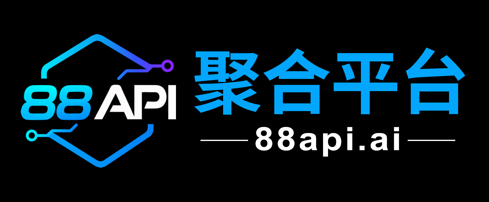
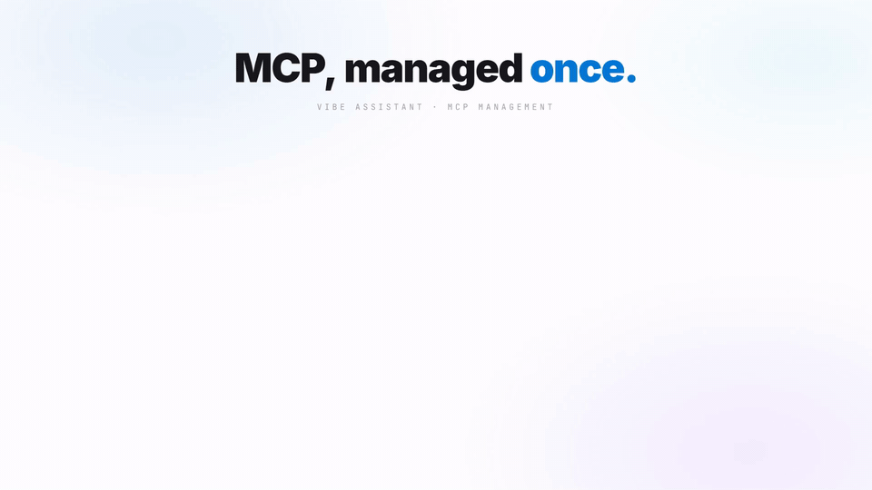
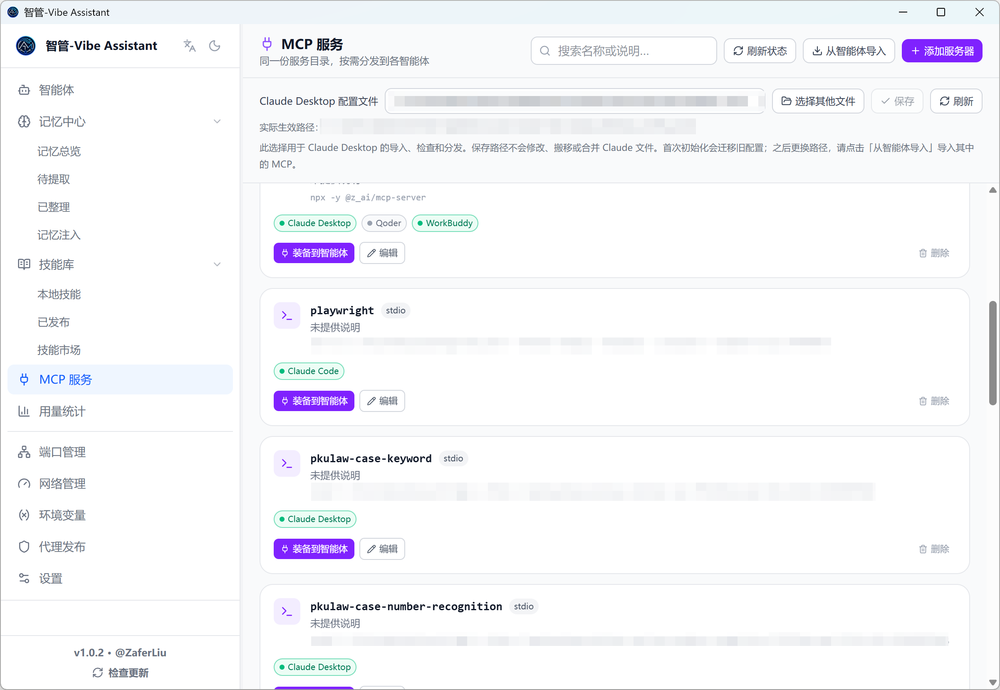
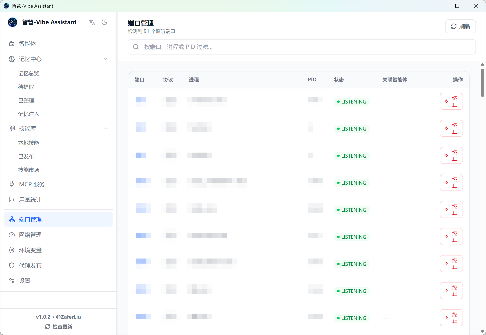
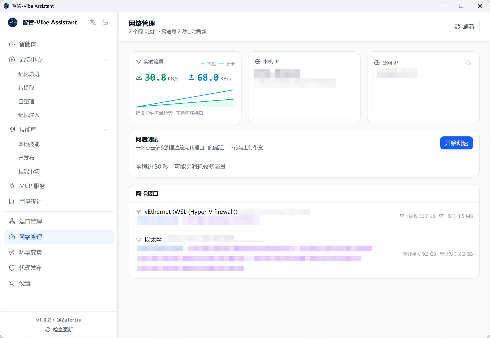
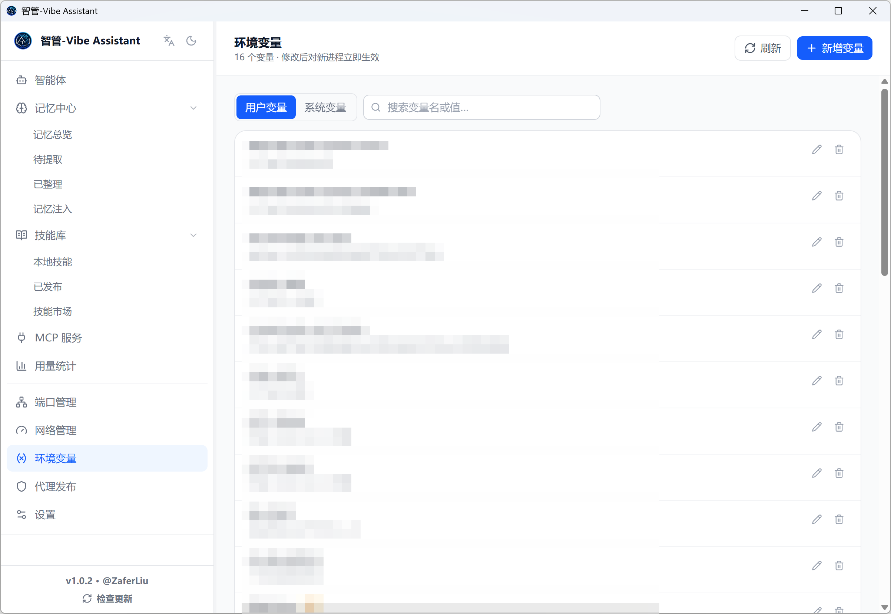
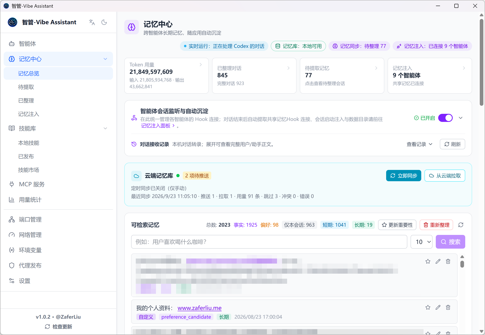
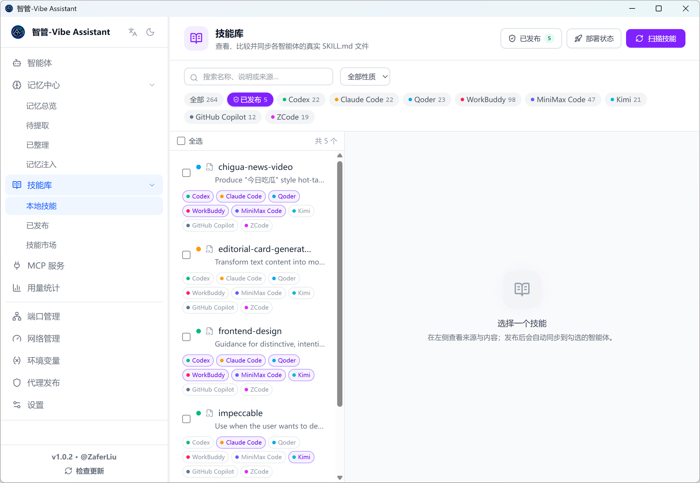
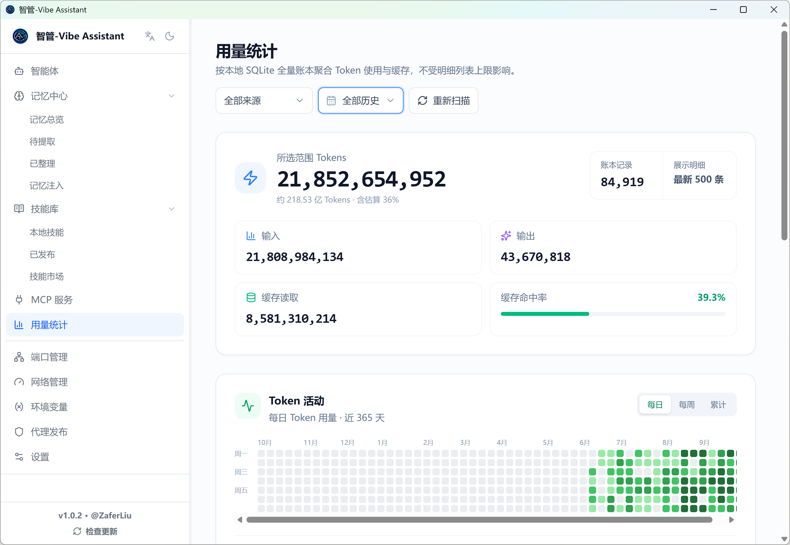

<div align="center">


# 智管-Vibe Assistant

**One workspace for memory, Skills, and MCP.**

[](https://github.com/Zafer-Liu/Vibe_Assistant/releases)
[](LICENSE)
[](https://github.com/Zafer-Liu/Vibe_Assistant/stargazers)
[](https://github.com/Zafer-Liu/Vibe_Assistant/actions)
[](#install)
[](https://tauri.app)
[](https://react.dev)
[](https://www.rust-lang.org)
[](https://88api.ai/sign-up?aff=VNNV)

[✨ Highlights](#highlights) · [🧠 Memory Center](#memory) · [⚙️ Install](#install) · [🚀 Quick Start](#quickstart) · [❓ FAQ](#faq)

**[简体中文](./README_ZH.md)** | English

</div>

---

<a id="sponsors"></a>

## 💖 Sponsors

Thanks to **[88API](https://88api.ai/sign-up?aff=VNNV)** for sponsoring this project! 88API is a one-stop multi-model API platform operated by a Hong Kong company, built for developers, creators, and AI app users. It exposes a unified interface to text, image, voice, and video models — covering AI programming, smart translation, content creation, dubbing, image generation, and video generation in common workflows. You can add and switch providers directly inside Vibe Assistant, with international payment methods, invoices, and enterprise-grade reliability. **[Sign up via this link](https://88api.ai/sign-up?aff=VNNV)** to get an exclusive bonus credit!

<p align="center">
  <a href="https://88api.ai/sign-up?aff=VNNV"></a>
</p>

---


## ✨ Highlights

**Vibe Assistant** is a local Tauri 2 + React 19 + Rust desktop workspace focused on:

- **Memory management**: capture and search conversations, maintain working memory and a long-term Profile, and inject context into connected clients.
- **Skill management**: browse, publish, and deploy skills, review local differences, and reuse equipment profiles.
- **MCP management**: manage services and client configurations, discover tools, and inspect calls and errors.
- Supporting tools: token usage, ports, networking, environment variables, backups, and cloud memory sync; Chinese/English and light/dark themes.

Process launching, embedded terminals and Web UIs, collaboration tasks, and proxy publishing have been removed. Existing clients such as Claude and Codex still use their memory, Skill, and MCP integrations. Saved memories, configurations, and historical output files are preserved.

---

## 🎬 How It Works

Three systems, one goal: give every agent the same memory, skills, and tools without copying config or losing track of who said what.

| System | The problem it solves | Watch it work |
|--------|----------------------|---------------|
| **🧬 Memory** | Injecting full history blows up context; injecting nothing loses continuity | [L0→L3 pipeline](#memory-deep-dive) |
| **🔌 MCP** | Each agent wants its own config format; debugging calls across 10 clients is hell | [Unified management](#mcp-deep-dive) |
| **📚 Skills** | Copying SKILL.md files between agents; version drift you can't see | [Shared library](#skill-deep-dive) |

---

## 📑 Table of Contents

- [How It Works](#how-it-works)
- [Memory Center](#memory)
  - [Memory deep dive: L0–L3](#memory-deep-dive)
- [Skill management](#skills)
  - [Skill deep dive: scan → publish → equip](#skill-deep-dive)
- [MCP Server Center](#mcp)
  - [MCP deep dive: one config, ten clients](#mcp-deep-dive)
- [System Toolkit](#system)
- [Install](#install)
- [Quick Start](#quickstart)
- [Model configuration](#llm-config)
- [Data Storage](#data-paths)
- [Telemetry and hooks](#telemetry)
- [FAQ](#faq)
- [Contributing](#contributing)
- [License](#license)

---

<a id="mcp"></a>

## 🔌 MCP Server Center

A single catalog for MCP servers on your machine — manage them once, distribute everywhere.

<a id="mcp-deep-dive"></a>

### 🎬 How MCP flows: one config → ten clients



One catalog defines your MCP servers; Vibe Assistant writes each client's native config format (Claude JSON, Codex TOML, dsh YAML, and seven others). A stdio relay sits between agent and server to observe call boundaries (server, tool, success, latency — never arguments or content) and reports to a local telemetry ledger. Config changes hot-reload into running clients without restarts.

**Why it matters**: stop hand-editing ten config files; debug "which tool failed and when" across every agent in one place; your prompts and tool outputs never leave your machine.



**Local server management**

- **Local scan**: auto-detects npm-global MCP packages
- **Smart parsing**: paste any text (docs, install instructions) and AI extracts the config
- **Manual entry**: stdio / SSE configurations

**Catalog & distribution**

- Keep frequently used MCP servers as catalog entries
- One-click install into Claude Code, Claude Desktop, Codex CLI, Codex Desktop, Qoder, WorkBuddy, MiniMax Code, Kimi, ZCode, and more
- Import from Agents' existing configs; per-host install status shown live (installed / config drift)

---

<a id="system"></a>

## 🧰 System Toolkit

<a id="ports"></a>

### Port Manager



- Every listening port with protocol, PID, and process name
- Kill the process occupying a port in one click — the fastest way to diagnose "port already in use" startup failures

<a id="network"></a>

### Network Manager



- **Live throughput** per network interface, with a rolling download/upload chart
- **Interface list** with IPv4 / IPv6 addresses, MAC, and MTU
- **Public IP** for both direct and proxy egress (detects your proxy automatically)
- **Bandwidth speed test** — latency, download, and upload over both direct and proxy paths

<a id="env"></a>

### Environment Variables



The equivalent of Windows' "Edit environment variables" dialog, without opening the registry editor:

- **User and system** scopes in separate tabs (system changes need an administrator-run app)
- **PATH-style variables are edited one entry per line** — add, remove, and reorder paths visually instead of fighting a semicolon blob
- Values containing `%REFERENCES%` are stored as `REG_EXPAND_SZ` with an expanded-value preview
- Changes are broadcast (`WM_SETTINGCHANGE`) so newly started processes pick them up immediately
- Critical variables (PATH, PATHEXT, WINDIR, …) are protected from accidental deletion

---

<a id="memory"></a>

## 🧬 Memory Center — One Brain for All Agents

Every coding Agent you use remembers your preferences, decisions, and current work — and every other Agent benefits from it.

<a id="memory-deep-dive"></a>

### 🎬 How memory flows: L0 → L3


Every conversation an agent completes becomes raw events (L0). An LLM extracts 1–3 typed records per session (L1). Every 30 days of L1 evidence consolidates into working memory (L2). A human-reviewed draft of L2 publishes as the long-term profile (L3) that every connected agent receives at session start. The split keeps context budgets small while preserving an audit trail back to the original conversation.

**Why it matters**: durable memory without the "paste 500K tokens of history" cost; a human gate prevents model mistakes from polluting long-term preferences.



### The L0–L3 memory model

| Layer | Name | Source | Role |
|-------|------|--------|------|
| L0 | Event ledger | Hook events / local transcript scans | Audit source; never injected as a whole |
| L1 | Retrievable memories | 1–3 facts / decisions / constraints / preferences extracted at session end | Semantic + keyword recall on demand |
| L2 | 30-day working memory | Map-reduce compression of recent L1 evidence | Injected at session start |
| L3 | Long-term Profile | Drafted from L2, gated by review before publishing | Injected every turn — stable preferences and constraints |

### 📥 Automatic capture (Agents → memory)

- Supports **Codex, Claude Code, Qoder, WorkBuddy, MiniMax Code, Kimi, GitHub Copilot, ZCode, and DeepSeek Harness** — via hooks (the first four) or local transcript scanning (all nine; DeepSeek Harness zstd-compressed sessions are decoded in place). DeepSeek Harness also gets hook-equivalent automatic injection through its cordis pre-step plugin
- Sessions land in a local SQLite ledger first, extraction runs async — nothing is lost when offline or before a model is configured; failed sessions can be re-run manually
- **Pending Memories** and **Organized Conversations** panels show full conversations, extraction progress, and failure reasons
- L1 cleaning & dedup ("dreaming"): local BGE semantic candidates + LLM arbitration, with rollback checkpoints
- **Import from a folder**: point the app at any transcript folder and extract memories from it directly

### 🔎 Search, ranking & the memory engine

- **Semantic search** across all L1 memories (hybrid semantic + keyword) right in the Memory Center
- **Importance ranking**: every memory gets a score with its evidence (supporting sessions, Agents, recall count); pin what matters
- **Memory engine**: the optional local semantic sidecar (status visible in the Memory Center) can be started / stopped on demand
- Inline edit / delete of any memory, plus manually added entries
- Reset-all-for-re-extraction when you want a clean rebuild of L1

### ⏱️ Scheduled L2/L3 refresh

The published L2 working memory and L3 Profile no longer depend on clicking buttons:

- Checks every 30 minutes while the app runs; rebuilds **L2** when new memories arrived and the configured interval (default **7 days**) elapsed
- Rebuilds and **auto-publishes L3** when L2 changed and its interval (default **30 days**) elapsed
- Intervals and the on/off switch live in **Settings → Scheduled memory refresh**; changes apply immediately
- Every background run is logged on the Memory Injection page; manual consolidation still works anytime

### 💉 Memory injection (memory → Agents, dual channel)

| Channel | Mechanism | Best for |
|---------|-----------|----------|
| Hook injection | SessionStart injects L2 once; UserPromptSubmit injects L3 every turn (content-fingerprint gated — unchanged turns cost zero tokens) | Working context at start, durable preferences throughout |
| Shared-memory MCP | Agents call `recall_memory` for semantic search on demand | Task-specific recall without bloating context |

**One-click setup**: install / uninstall the shared-memory MCP into **Claude Code, Claude Desktop, Codex CLI, Codex Desktop, Qoder, WorkBuddy, MiniMax Code, Kimi, ZCode, DeepSeek Harness**, and manage capture/injection hooks for the four hook-capable Agents (Claude Code, Codex, Qoder, WorkBuddy). Per-device data directory overrides are supported.

### 🔗 DeepSeek Harness bridge plugin

[dsh-vibe-assistant-bridge](https://github.com/Zafer-Liu/dsh-vibe-assistant-bridge) is the official bridge plugin that turns DeepSeek Harness into a first-class Vibe Assistant citizen — one bundle, six capabilities:

| Capability | What it does |
|------------|--------------|
| **Memory injection** | L2/L3 shared memory folded into every session start (offline snapshot fallback) |
| **MCP observation** | Tool call boundaries reported to the local ledger (no arguments, no content) |
| **Token usage** | Per-message usage reported in real time, deduplicated against transcript scans |
| **Collection trigger** | Session end signals immediate L0→L1 extraction (no waiting for the scan cycle) |
| **Recall tools** | `recall_memory` / `get_user_profile` as native dsh tools |
| **Skill tools** | `list_shared_skills` / `read_shared_skill` as native dsh tools |

**Install**: click **一键接入** (one-click setup) in Vibe Assistant's MCP library, or in the dsh desktop app go to **Plugins → Add plugin** and paste `dsh-vibe-assistant-bridge`. Requires Vibe Assistant running locally (loopback HTTP on port 9420).

**Source & development**: [Zafer-Liu/dsh-vibe-assistant-bridge](https://github.com/Zafer-Liu/dsh-vibe-assistant-bridge) (MIT). Also discoverable in the community plugin directory via the `dsh-plugin` topic.

### ✍️ Custom memories

Hand-written entries under the working-memory or long-term cards — only you can edit or delete them, automatic cleaning never touches them, and they are always injected.

<a id="skills"></a>

### 📚 Shared Skill library & marketplace

<a id="skill-deep-dive"></a>

### 🎬 How skills flow: scan → publish → equip


Every agent's `SKILL.md` files scan into one shared library, keyed by content hash. Before any sync you preview exactly what will be added (green), updated (yellow), or conflicted (red). "Publish + equip" writes approved skills back to every agent's directory in one step. Version drift is visible per agent; one click rolls back the latest publish or adopts a local edit as the new shared version. The marketplace installs curated skills from official OpenAI and Anthropic repositories with size bounds and path validation.

**Why it matters**: no more "which agent has the latest version of this skill"; conflicts are explicit choices, not silent overwrites; marketplace skills are audited before they touch disk.



- **Skill library**: scans each Agent's `SKILL.md` files into a shared library; content-hash previews of adds / updates / conflicts before you confirm a sync; "publish + equip" in one step, with bulk operations, per-Agent version drift detection, one-click rollback of the latest publish, and "adopt local" to take an Agent's local edit as the new shared version
- **Marketplace**: browse and install curated skills from the official **OpenAI** and **Anthropic** skill repositories — downloads are size-bounded, every relative path validated, and downloaded scripts are never executed

### 📊 Token usage analytics



Aggregates real input / output / cache usage from local transcripts across Agents — coverage includes Codex, Claude Code, Qoder, WorkBuddy, MiniMax Code, Kimi, GitHub Copilot, Gemini CLI, OpenCode, OpenClaw, and more — aligned with how providers bill:

- Summary dashboard plus per-session usage records and live session activity
- Injection dashboard: per-source session/prompt injection counts, fingerprint-gate hit rate, and estimated token cost

### ☁️ Cloud Memory Vault (optional)

Sync published L2/L3 documents and custom memories across machines — one brain everywhere:

- **AES-256-GCM end-to-end encryption**: keys derived from your sync password, never stored; the server only ever sees ciphertext
- CAS conflict detection, incremental pulls, tombstone deletions; local SQLite stays authoritative, offline sync failures never block injection
- Single-file self-hostable server, open source in [`vault/`](vault/README.md) — Docker / Railway / Orange Pi + Tailscale

---

<a id="install"></a>

## ⚙️ Install

### Download a prebuilt package (recommended)

Grab the latest from [Releases](https://github.com/Zafer-Liu/Vibe_Assistant/releases):

| Platform | Package |
|----------|---------|
| Windows x64 | `-x64-setup.exe` (NSIS installer) |
| macOS Apple Silicon | `-aarch64.dmg` |
| macOS Intel | `-x64.dmg` |
| Linux x64 | `-amd64.AppImage` / `-amd64.deb` |

### Build from source

**Prerequisites**: [Node.js](https://nodejs.org) ≥ 18, [Rust](https://rustup.rs) stable, and the [Tauri prerequisites](https://tauri.app/start/prerequisites/) (VS C++ Build Tools on Windows).

```bash
git clone https://github.com/Zafer-Liu/Vibe_Assistant.git
cd Vibe_Assistant

# install dependencies
npm install
cd frontend && npm install && cd ..

# development
npm run dev

# production build
npm run build
```

Bundles land in `src-tauri/target/release/bundle/`.

On Windows, `npm run dev` sets the Cargo build directory to Medium integrity so executables do not inherit a sandbox checkout's Low label and fail to write AppData with a SQLite read-only error. This preflight only adjusts build output, preserving database and checkout permissions.

---

<a id="quickstart"></a>

## 🚀 Quick Start

1. Read the Memory, Skill, and MCP introduction on first launch, or reopen it from Settings. Memory Center is the default page.
2. Add a project detail or preference manually. For automatic extraction, configure and verify a memory model in Settings, then check capture and injection.
3. Read a local Skill and publish it to selected clients. Review deployment and differences in Published.
4. Import or add an MCP service, check its command or URL, select clients, and inspect tools and call records.

No CLI import or process launch is required.

---

<a id="llm-config"></a>

## 🤖 LLM Configuration

MCP parsing and memory extraction need an LLM. Add one under **Settings → LLM and memory extraction**:

| Field | Meaning | Example |
|-------|---------|---------|
| Name | Anything you like | DeepSeek |
| Base URL | Any OpenAI-compatible API | `https://api.deepseek.com/v1` |
| API Key | Provider API key | `sk-xxx` |
| Model | Model name | `deepseek-chat` |

Hit **Test Connection** — green means good.

**Built-in presets**: DeepSeek (`deepseek-chat`), OpenAI (`gpt-4o-mini`), or any custom OpenAI-compatible endpoint. Keys are encrypted at rest (AES-256-GCM, machine-bound).

**Local models (Ollama)**: the settings page has a built-in Ollama module — connect, list pulled models with size / quantization, and promote one to a custom provider or the memory-extraction model in one click.

---

<a id="data-paths"></a>

## 📁 Data Storage Paths

| Data | Windows | macOS / Linux |
|------|---------|---------------|
| Legacy runtime configs (preserved, unused) | `%APPDATA%\agent-manager\agents.json` | `~/Library/Application Support/agent-manager/` (macOS), `~/.local/share/agent-manager/` (Linux) |
| LLM providers | `%APPDATA%\agent-manager\llm_config.json` | same directory |
| Memory & telemetry DB | `%APPDATA%\agent-manager\telemetry.sqlite3` | same directory |
| Agent source overrides | `%APPDATA%\agent-manager\agent_source_paths.json` | same directory |
| Historical Caddyfile (unused) | `%APPDATA%\agent-manager\Caddyfile` | same directory |
| Claude Desktop MCP config | `%APPDATA%\Claude\claude_desktop_config.json` | `~/Library/Application Support/Claude/claude_desktop_config.json` |

The Settings page offers one-click **export / import** of a full config backup for migration and disaster recovery.

---

<a id="telemetry"></a>

## 🔌 Telemetry & External Access (experimental)

The memory pipeline uses local SQLite as its event ledger: hook events are persisted first and extracted asynchronously, so an offline model never loses captured sessions.

- **Codex, Claude Code, Qoder**: per-Agent hooks install/uninstall from the Memory Center; port and auth follow the external-trigger settings
- **WorkBuddy**: never writes to its Claude Code config (no double capture); can submit aggregated session / usage data via the standard telemetry endpoint
- **Token accounting**: Codex, Claude, and WorkBuddy read real usage from local transcripts; sources without complete provider usage show clearly-marked local estimates. Stray hook events are audit-only and never double-counted; adapters can overwrite estimates with real final numbers via `session_usage`

Standard endpoint: `POST http://127.0.0.1:<hook-port>/telemetry/events/{codex|workbuddy|claude|qoder}`

```json
{
  "session_id": "stable-session-id",
  "event": "session_usage",
  "cwd": "D:/Github-repo/example",
  "usage": { "input_tokens": 120, "output_tokens": 48, "cached_tokens": 60 },
  "usage_scope": "session"
}
```

`input_tokens` must be the session's full input total; `cached_tokens` is display-only detail (do not add it into totals). Re-submissions for the same `source + session_id` overwrite instead of accumulate.

<a id="whats-new"></a>

## 🗺️ What's New

> **Current version `v1.1.0`**

**v1.1.0**

- ✅ **Cloud vault sync** — WebDAV / S3-compatible storage join the built-in vault server for encrypted memory sync
- ✅ **88API built-in provider** — sponsor entry bundled, model lists fetched automatically, no manual entry for new models
- ✅ **Cancellable memory extraction** — pending extractions can be cancelled in the Pending Memories panel; failed sessions can still re-run
- ✅ **Light theme by default** — fresh installs start in light mode; dark mode remains available in settings
- ✅ **Feature-focus slimming** — process launcher, embedded terminal / Web UI, collaboration tasks, and agent publishing retired; memory, settings, and historical artifacts are fully preserved

**v1.0.x**
- ✅ **Project renamed to Vibe Assistant** (智管-Vibe Assistant) — display name, prompts, docs, and window title; protocol identifiers and data paths unchanged, so existing hooks, MCP installs, and local data keep working
- ✅ **Environment Variables manager** — user/system scopes, PATH edited one entry per line, `REG_EXPAND_SZ` previews, protected critical variables
- ✅ **Scheduled L2/L3 memory refresh** — configurable intervals (default L2 7 days / L3 30 days), model calls only when new memories exist, L3 auto-publish
- ✅ **Network Manager** — live per-interface throughput, public-IP (direct + proxy egress) and dual-path bandwidth speed tests
- ✅ **Skill Marketplace** — install curated skills from official OpenAI / Anthropic repositories into the shared Skill library
- ✅ **Workflow feature removed** — the visual workflow builder, task board, and run history were retired to keep the app focused (see release notes for history)
- ✅ **L1 extraction hardening** — truncated-JSON salvage, contract-drift tolerance, and model-output excerpts in error messages for diagnosable failures

📖 [Full changelog](https://github.com/Zafer-Liu/Vibe_Assistant/releases)

---

<a id="faq"></a>

## ❓ FAQ

<details>
<summary><b>🧬 Memory Center</b></summary>

<details>
<summary><b>A session never became a memory?</b></summary>

Check in order:

1. Memory extraction needs an LLM: confirm at least one provider passes **Test Connection** in **Settings → LLM and memory extraction** (or an Ollama model is attached)
2. Open **Memory Center → Pending Memories** — is the session queued? What is the failure reason? (Failures quote the model's raw output for diagnosis.)
3. Confirm the Agent's capture hook is installed, or its transcript directory is configured correctly
4. Failed sessions can be re-run from the panel

</details>

<details>
<summary><b>Edits to the L3 Profile don't take effect?</b></summary>

L3 uses a draft → publish gate: a draft must be **published** before it is injected. Published profiles can be edited directly — changes apply immediately. If retrieval via MCP returns stale content, confirm the host's shared-memory MCP is connected.

</details>

<details>
<summary><b>How often are L2 / L3 refreshed?</b></summary>

On schedule, without any clicks: every 30 minutes the app checks whether new memories arrived and whether the configured interval (default L2 7 days, L3 30 days) elapsed. Adjust or disable under **Settings → Scheduled memory refresh**. Every run is logged on the Memory Injection page.

</details>

<details>
<summary><b>Cloud Vault sync conflict?</b></summary>

Local SQLite is always authoritative; a unreachable vault never blocks injection. On conflict the app asks which side to keep. The server only stores AES-256-GCM ciphertext and cannot read or alter content.

</details>

</details>


<details>
<summary><b>⚙️ Install & Runtime</b></summary>

<details>
<summary><b>Windows: "Unknown publisher" warning?</b></summary>

Click **More info → Run anyway** — the installer is not Microsoft code-signed.

</details>

<details>
<summary><b>macOS: "can't be opened because it is from an unidentified developer"?</b></summary>

```bash
xattr -d com.apple.quarantine /Applications/智管-Vibe\ Assistant.app
```

Or right-click the app → **Open** → **Open** again.

</details>

<details>
<summary><b>npm run dev says the port is in use?</b></summary>

The dev server uses port **1420**. Find and kill the holder:

```powershell
netstat -ano | findstr :1420
taskkill /PID <PID> /F
```

</details>

<details>
<summary><b>I renamed/updated the app and the shared-memory MCP stopped working?</b></summary>

A renamed install changes the executable path recorded in Agents' MCP configs. Open **Memory Center → Memory Injection** and reconnect the affected hosts once — after that, regular in-place updates keep working.

</details>

</details>

---

<a id="contributing"></a>

## 🤝 Contributing

PRs and issues are welcome:

1. **Fork** the repository
2. Create a feature branch (`git checkout -b feature/amazing-feature`)
3. Commit (`git commit -m 'feat: add amazing feature'`)
4. Push (`git push origin feature/amazing-feature`)
5. Open a **Pull Request**

Bugs and ideas: [Issues](https://github.com/Zafer-Liu/Vibe_Assistant/issues). For a dev setup see [Build from source](#install).

---

<a id="license"></a>

## 📄 License

[Apache 2.0](LICENSE)

---

<div align="center">

## ⭐ The Goal

**Keep useful context, reusable skills, and connected tools in one workspace.**

</div>
